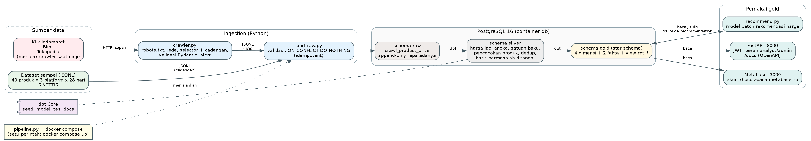
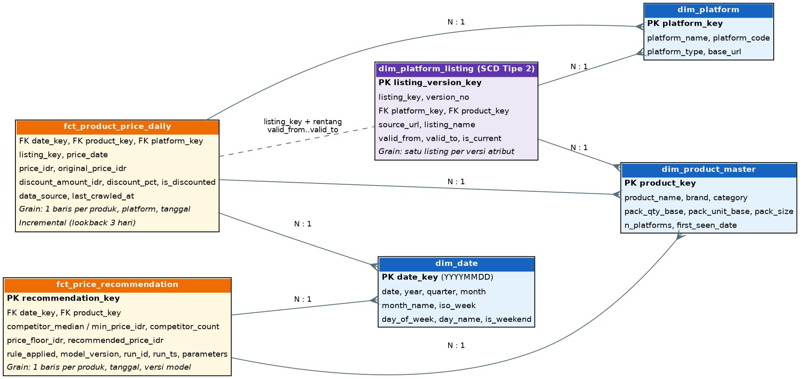
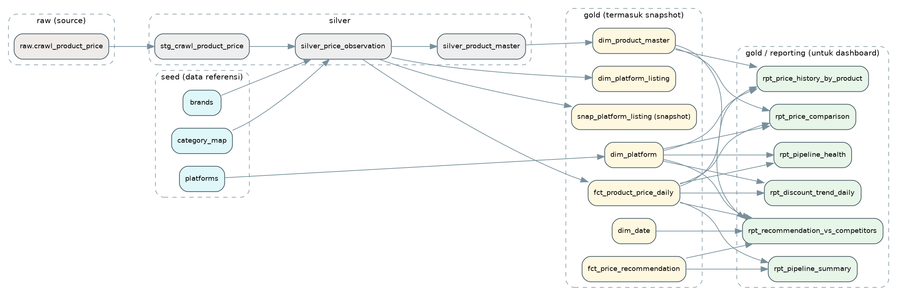
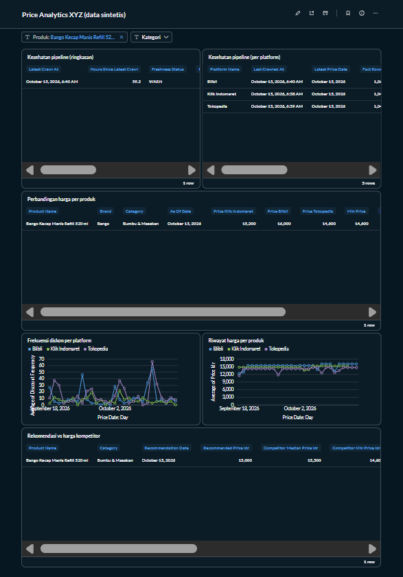
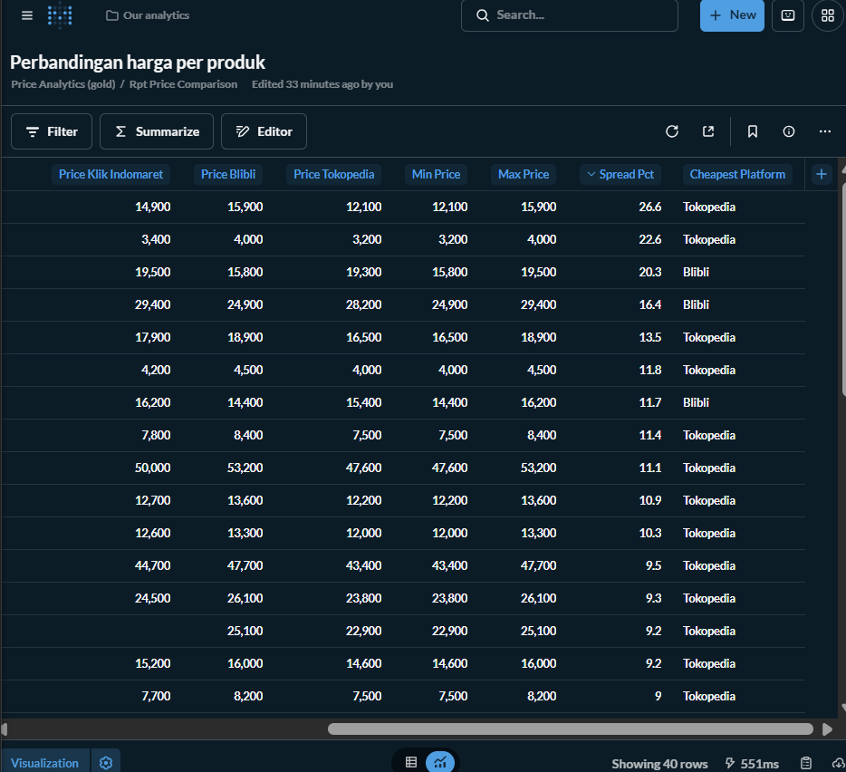
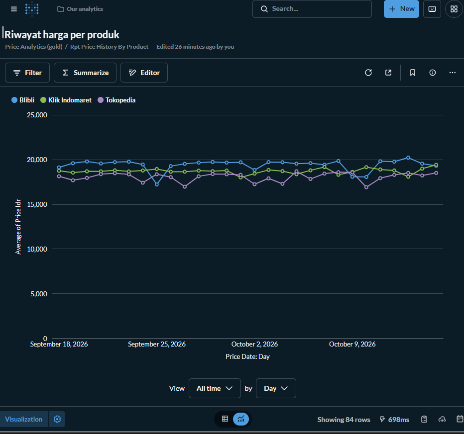
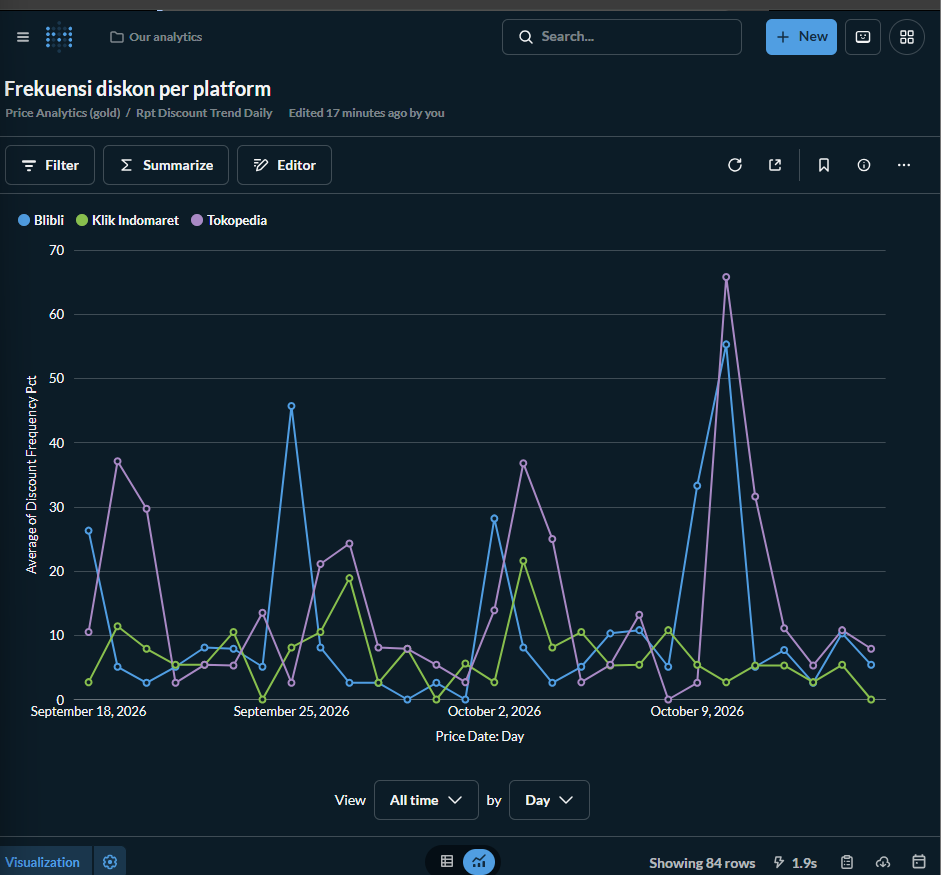
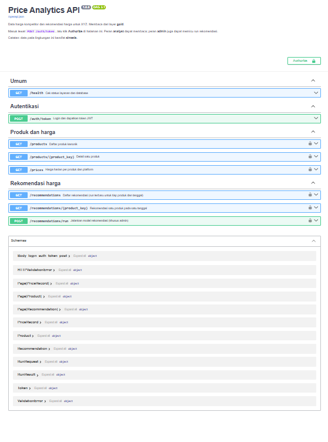

# Price Analytics: analisis harga kompetitor untuk XYZ

Sistem kecil dari ujung ke ujung untuk memahami pergerakan harga kompetitor: **ingestion, pemodelan dbt (raw, silver, gold), analisis SQL, dashboard Metabase, model rekomendasi harga, dan API FastAPI**. Semuanya berjalan dengan satu perintah: `docker compose up --build`.

> **Peringatan: data pada repository ini SINTETIS.**
> Klik Indomaret, Blibli, dan Tokopedia menolak crawler saat diuji (lihat [bagian 8](#8-crawler-dan-rencana-cadangan)), sehingga sistem memakai dataset sampel buatan sendiri (40 produk x 3 platform x 28 hari). Setiap baris bertanda `data_source = 'synthetic'`. Pola harga, diskon, dan perbedaan antar platform dirancang saat data dibuat. **Temuan analisis membuktikan bahwa sistem bekerja, bukan menggambarkan pasar yang sebenarnya.**

## Daftar isi

1. [Cara menjalankan](#1-cara-menjalankan)
2. [Mencoba API](#2-mencoba-api)
3. [Menjalankan tes](#3-menjalankan-tes)
4. [Arsitektur](#4-arsitektur)
5. [Struktur repository](#5-struktur-repository)
6. [Model data](#6-model-data)
7. [Pemetaan ke lakehouse](#7-pemetaan-ke-lakehouse)
8. [Crawler dan rencana cadangan](#8-crawler-dan-rencana-cadangan)
9. [Analisis dan ringkasan bisnis](#9-analisis-dan-ringkasan-bisnis)
10. [Dashboard](#10-dashboard)
11. [API](#11-api)
12. [Keputusan desain dan trade-off](#12-keputusan-desain-dan-trade-off)
13. [Keterbatasan dan rencana jika ada waktu lebih](#13-keterbatasan-dan-rencana-jika-ada-waktu-lebih)
14. [Penggunaan AI](#14-penggunaan-ai)
15. [Tangkapan layar](#15-tangkapan-layar)

---

## 1. Cara menjalankan

**Prasyarat:** Docker Desktop dan Git. Alokasikan memori Docker minimal sekitar 4 GB (Metabase sendiri membutuhkan sekitar 2 GB).

```bash
git clone https://github.com/Hendrimegaputra24/Test-DWHOperation-BFI.git
cd Test-DWHOperation-BFI
cp .env.example .env            # Windows PowerShell: Copy-Item .env.example .env
docker compose up --build
```

File `.env.example` berisi **nilai demo** agar langsung bisa dijalankan. Ganti sebelum dipakai di tempat lain.

**Yang terjadi, berurutan:**

1. `db`: PostgreSQL 16 menyala.
2. `pipeline`: membuat skema raw, memuat data, menjalankan `dbt build` (seed, model, tes), membuat akun database khusus-baca, mengecek freshness, lalu menjalankan model rekomendasi. Container ini berhenti sendiri setelah selesai (`Exited (0)` itu benar). Log berakhir dengan `pipeline_done`.
3. `api`: FastAPI menyala setelah pipeline sukses.
4. `metabase`: Metabase menyala setelah pipeline sukses.

Build pertama dan pipeline memakan beberapa menit. Pada mesin pengembangan (Windows, sumber daya terbatas) pipeline memakan sekitar 7 menit.

| Layanan | Alamat | Keterangan |
|---|---|---|
| API dan dokumentasi | http://localhost:8000/docs | Swagger UI (OpenAPI) |
| Dashboard | http://localhost:3000 | Metabase, lihat [bagian 10](#10-dashboard) |
| Database (dari komputer host) | `localhost:5433` | Port 5433 menghindari bentrok dengan PostgreSQL lokal di 5432 |

**Akun demo** (dari `.env.example`):

| Untuk | Username | Password |
|---|---|---|
| API, peran analyst (baca) | `analyst` | `analyst-demo-password` |
| API, peran admin (baca dan memicu run) | `admin` | `admin-demo-password` |
| Database (klien SQL) | `pricer` | `pricer_pass` (database `price_analytics`) |
| Metabase ke database | `metabase_ro` | `metabase-demo-password` (host `db`, port `5432`) |

**Menghentikan:** `docker compose down` mempertahankan data. `docker compose down -v` **menghapus semuanya**, termasuk dashboard Metabase.

**Menjalankan ulang aman:** pipeline idempotent. Pemuatan kedua melaporkan `inserted: 0` dan seluruh baris sebagai duplikat yang dilewati.

### Airflow (opsional): penjadwalan otomatis

Airflow menjalankan ulang pengolahan data **tiap malam pukul 01.00 (Asia/Jakarta)**. Ia hanya
mengatur urutan dan jadwal; pekerjaan sebenarnya dikerjakan skrip yang sama dengan `docker compose up`.
Airflow **tidak menyala secara bawaan**, jadi cara menjalankan di atas tidak berubah. Untuk menyalakannya:

```bash
docker compose --profile airflow up -d --build
```

| Apa | Nilai |
|---|---|
| Alamat | http://localhost:8088 |
| Login | `admin` / `airflow-demo-password` (dari `.env.example`) |
| DAG | `price_pipeline_daily`: `run_crawler`, lalu `run_dbt_build`, lalu `run_pricing_model` |

Tiap task hanya jalan bila task sebelumnya sukses; bila gagal diulang 2 kali. Data sampel **statis**, jadi
run terjadwal sukses tetapi tidak menambah data baru (`inserted: 0`); yang dibuktikan adalah
orkestrasinya. Rincian ada di [docs/airflow.md](docs/airflow.md).

## 2. Mencoba API

Buka http://localhost:8000/docs, lalu:

1. Klik **Authorize**, masuk sebagai `analyst`.
2. `GET /products` dengan `limit = 5` memberi `total: 40`.
3. `GET /prices` dengan `platform = Blibli`, `date_from = 2026-10-10`, `date_to = 2026-10-12`.
4. `POST /recommendations/run` sebagai `analyst` memberi **403**.
5. Logout, masuk sebagai `admin`, ulangi langkah 4: **200** beserta `run_id`.
6. `GET /prices` dengan `date_from` lebih besar dari `date_to` memberi **422**. Mengisi `limit = 1000` ditolak (maksimum 200).

## 3. Menjalankan tes

```bash
pip install -r requirements.txt
docker compose up -d db          # database harus menyala
python src/pipeline.py           # sekali, agar tabel gold terisi (membaca .env)
python -m pytest -q              # 44 tes
```

| Tes | Isi |
|---|---|
| `tests/test_api.py` | Login, peran (401, 403, 200), paginasi, filter, validasi (422) |
| `tests/test_api_reads_gold_only.py` | Statis: semua query API hanya mengacu ke schema `gold` |
| `tests/test_crawler.py` | Selector cadangan, JSON-LD, validasi, alert, deteksi blokir, robots.txt, jeda, idempotency |
| `tests/test_check_access.py` | Pengenalan status situs, laporan uji akses, kontak wajib |
| `tests/test_airflow_dag.py` | Struktur DAG Airflow (jadwal, urutan task), opsi `--step`, profil `airflow` di compose |
| `dbt build` | 103 hasil (seed, model, snapshot, dan tes data) lulus, termasuk 9 tes kustom di `dbt/tests` |

Perintah singkat lain ada di `Makefile` (`make pipeline`, `make test`, `make dbt`, `make dbt-docs`; butuh `make`, bisa lewat WSL). Pengguna Windows dapat menjalankan perintah di dalamnya secara langsung.

**Dokumentasi dbt dan lineage graph:**

```bash
cd dbt
dbt docs generate --profiles-dir .
dbt docs serve --profiles-dir . --port 8081      # lalu buka http://localhost:8081
```

Variabel database (`POSTGRES_*`, `DB_HOST`, `DB_PORT`) harus tersedia di environment. Diagram lineage yang dibuat dari manifest dbt ada di [bagian 6](#6-model-data).

## 4. Arsitektur



Prinsip: **crawler (atau loader) hanya menulis ke raw, dbt membangun silver dan gold, dan semua yang ada di hilir membaca dari gold**. API dan Metabase tidak pernah membaca raw atau silver; Metabase memakai akun database khusus-baca yang secara teknis hanya punya hak `SELECT` di schema `gold`.

## 5. Struktur repository

```
.
├── docker-compose.yml        # db, pipeline, api, metabase (+ airflow, opsional)
├── Dockerfile                # satu image untuk pipeline dan api
├── Makefile                  # perintah singkat
├── .env.example              # konfigurasi contoh (nilai demo)
├── requirements.txt
├── config/selectors.yml      # selector crawler + cadangan, URL awal, ambang alert
├── airflow/                  # DAG penjadwal (opsional): dags/, Dockerfile, start.sh
├── sql/01_raw_schema.sql     # tabel raw.crawl_product_price
├── data/sample/              # 28 file JSONL (sintetis), satu per hari crawl
├── src/
│   ├── pipeline.py           # skema -> muat data -> dbt -> role baca -> freshness -> rekomendasi (opsi --step dipakai Airflow)
│   ├── crawler.py            # crawler sopan, selector cadangan, validasi, alert
│   ├── load_raw.py           # validasi Pydantic, idempotent ke tabel raw
│   ├── recommend.py          # model batch rekomendasi harga
│   └── run_analyses.py       # menjalankan analisis SQL dan menyimpan CSV
├── dbt/
│   ├── models/raw            # deklarasi source + freshness
│   ├── models/silver         # stg_*, silver_price_observation, silver_product_master
│   ├── models/gold           # dim_*, fct_*, dan reporting/rpt_* (view untuk dashboard)
│   ├── seeds/                # brands, category_map, platforms
│   ├── tests/                # 9 tes kustom (singular)
│   ├── analyses/             # q1..q4: jawaban pertanyaan bisnis (SQL)
│   └── macros/               # generate_schema_name (nama schema persis silver/gold)
├── api/                      # FastAPI: main, security (JWT, peran), config, db, schemas
├── tests/                    # pytest: API, gold-only, crawler, check_access, DAG Airflow (+ fixtures HTML)
└── docs/
    ├── business_summary.md   # ringkasan satu halaman untuk pimpinan
    ├── dashboard_setup.md    # langkah membuat ulang dashboard
    ├── analysis_results/     # hasil analisis (CSV)
    ├── crawl_evidence/       # bukti percobaan crawl
    ├── diagrams/             # arsitektur, ERD, lineage (PNG dan sumber .dot)
    └── screenshots/
```

## 6. Model data

Satu folder dbt dan satu schema database per layer:

| Layer | Schema | Isi | Bentuk |
|---|---|---|---|
| raw | `raw` | Hasil crawl apa adanya (harga masih teks "Rp 14.500"), append-only, ditambah metadata: `crawled_at`, `source_url`, `platform`, `crawler_version`, `payload_hash`, `data_source`. Dideklarasikan sebagai dbt source dengan cek freshness. Tanpa logika bisnis. | tabel |
| silver | `silver` | Teks menjadi angka, satuan dibakukan (L ke ml, kg ke g), deduplikasi per listing per hari, pencocokan produk lintas platform, baris bermasalah ditandai (`is_valid`, `dq_issue`). | view |
| gold | `gold` | Star schema untuk analis, dashboard, dan API, ditambah view `rpt_*` khusus dashboard. | tabel, incremental, dan view |

### ERD dan grain



| Tabel fakta | Grain | Catatan |
|---|---|---|
| `fct_product_price_daily` | **Satu baris per produk, per platform, per tanggal crawl** (observasi valid terakhir pada hari itu) | Incremental. Hanya baris valid yang masuk. |
| `fct_price_recommendation` | **Satu baris per produk, per tanggal rekomendasi, per versi model** | Strukturnya dibuat dbt, barisnya diisi `recommend.py`. Menjalankan ulang dengan versi model yang sama menimpa baris yang sama. |

Relasi pada diagram bersifat **logis**: dijaga oleh tes `relationships` dbt, bukan oleh constraint foreign key di database.

**Pilihan desain star schema:**

- `fct_product_price_daily` hanya berisi ukuran numerik (harga, harga asli, diskon) dan kunci ke dimensi, sehingga mudah diagregasi.
- `dim_product_master` adalah produk **kanonik** lintas platform, hasil pencocokan, sehingga perbandingan antar platform cukup dengan `group by` pada satu kunci.
- `dim_date` dan `dim_platform` dibuat sebagai dimensi sendiri agar analisis per hari dalam minggu dan per platform tidak perlu menghitung ulang.
- `dim_platform_listing` memisahkan "produk" (konsep) dari "listing" (halaman produk di satu platform), karena nama listing bisa berubah.

### Riwayat atribut (SCD Tipe 2)

`dim_platform_listing` menyimpan versi nama listing dan produk kanonik yang cocok, dengan `valid_from`, `valid_to` (`9999-12-31` untuk versi berlaku), dan `is_current`. Pada data sampel, 3 dari 115 listing berganti nama, sehingga ada 118 versi. Selain itu ada **dbt snapshot** sungguhan, `snap_platform_listing` (strategi `check` pada nama listing dan produk kanonik). dbt mengisi `dbt_valid_from` dan `dbt_valid_to` dari waktu snapshot dijalankan, sehingga pada pemuatan historis sekaligus hanya terbentuk satu versi dan riwayat bertambah seiring snapshot dijalankan setelah tiap crawl. Mekanismenya dapat didemonstrasikan: `dbt snapshot --vars '{snapshot_as_of_date: 2026-10-01}'` lalu `dbt snapshot` mengubah 115 baris menjadi 118 (3 listing berganti nama). Model `dim_platform_listing` menghitung riwayatnya dari **tanggal crawl**, sehingga riwayat langsung terlihat pada data historis. Dua tes memastikan tiap listing punya tepat satu versi berlaku dan rentang versi tidak tumpang tindih.

### Strategi incremental

`fct_product_price_daily` memakai `delete+insert` dengan kunci unik (tanggal, produk, platform). Setiap run hanya memproses `price_date` dalam **3 hari terakhir** sebelum tanggal terbaru di tabel (lookback untuk koreksi atau crawl terlambat), lalu mengganti baris pada rentang itu. Diuji dengan menghapus dua hari terakhir lalu menjalankan ulang (data pulih), dan dengan `--full-refresh` (hasil sama).

### Pencocokan produk

Nama produk berbeda tiap platform (`BANGO KECAP MANIS REFILL 520ML`, `Bango Kecap Manis Refill 520 ml`, `Kecap Bango Manis Refill 520ml`). Pendekatan berbasis aturan:

1. Ukuran diambil dengan regex lalu dibakukan ke satuan dasar (`0,52 L` menjadi `520 ml`).
2. Nama dibersihkan (huruf kecil, tanda baca dibuang, ukuran dan kata promosi seperti "official", "promo", "pack" dibuang).
3. Kata-kata unik diurutkan, sehingga urutan kata tidak berpengaruh.
4. Kunci pencocokan = kata terurut + ukuran dasar. Hash-nya menjadi `product_key`.

Brand diambil dari daftar (seed), kategori dari pemetaan breadcrumb platform yang tidak ambigu (seed). Pada data sampel, hasilnya **sama persis dengan kunci jawaban**: 40 produk, tanpa produk tercampur atau terpecah, dan tiga listing yang berganti nama tetap cocok.

**Batas pendekatan ini:** data sampel dibuat dengan pola yang bisa ditangkap aturan, jadi akurasi sempurna itu tidak mewakili data nyata. Typo, singkatan, bundling ("isi 2"), dan varian baru akan menyebabkan salah cocok atau gagal cocok. Produk yang belum dikenali tetap masuk dengan label "Tidak terklasifikasi" dan brand "Tidak diketahui" (alih-alih menghentikan pipeline), sehingga jumlahnya bisa dipantau. Perbaikan: pencocokan fuzzy (trigram atau embedding) dengan ambang, antrean tinjauan manual, dan tabel pemetaan yang dikelola.

### Kualitas data

- **Generik:** `unique`, `not_null`, `relationships`, `accepted_values` pada raw, silver, dan gold.
- **Kustom (9 tes di `dbt/tests`):** harga lebih dari 0, `discount_pct` antara 0 dan 100, harga tidak melebihi harga asli, grain fakta unik, satu observasi per listing per hari, satu versi berlaku per listing, rentang versi tidak tumpang tindih, satu versi snapshot berlaku per listing, rekomendasi tidak di bawah batas bawah.
- **Freshness** pada source raw (`warn_after` 36 jam, `error_after` 72 jam). Karena data sampel statis, statusnya akan berubah menjadi `STALE` seiring waktu. Itu perilaku yang benar dan tidak menghentikan pipeline.
- **Baris bermasalah** (harga kosong, nol, diskon di luar 0 sampai 100, harga lebih besar dari harga asli) **ditandai di silver dan tidak masuk gold**. Pada data sampel ada 65 dari 3.220 observasi, sengaja disisipkan untuk menguji ini.

### Lineage



Diagram ini dibuat dari `manifest.json` dbt. Versi interaktif dari `dbt docs` dapat dibuka dengan perintah di [bagian 3](#3-menjalankan-tes).

## 7. Pemetaan ke lakehouse

Desain raw, silver, gold di sini adalah arsitektur medallion dalam bentuk kecil. Pemetaannya pada lakehouse sungguhan (misalnya object storage S3 atau OSS dengan tabel Apache Iceberg atau Delta Lake):

| Di proyek ini | Pada lakehouse |
|---|---|
| schema `raw`, append-only | **Bronze**: tabel Iceberg/Delta di object storage, dipartisi per `crawl_date`. File mentah (JSON atau HTML) juga disimpan di bucket dengan versioning atau object lock agar tidak bisa diubah. |
| schema `silver` (view) | **Silver**: tabel Iceberg/Delta yang dibangun dengan `MERGE` (upsert) berdasarkan kunci listing dan hari. |
| schema `gold`, tabel dan incremental `delete+insert` | **Gold**: tabel Iceberg/Delta. Incremental menjadi `MERGE` atau `insert_overwrite` per partisi `price_date`. Star schema yang sama. |
| PostgreSQL sebagai mesin | Mesin query terpisah dari penyimpanan: Spark, Trino, Athena, atau Databricks SQL, dengan katalog (Glue, Hive Metastore, Unity). |
| dbt-postgres | dbt-spark, dbt-athena, dbt-trino, atau dbt-databricks. Model SQL sebagian besar tetap, hanya fungsi spesifik Postgres (`regexp_match`, `distinct on`) yang perlu diganti. |
| idempotency: kunci unik dan `ON CONFLICT DO NOTHING` | `MERGE ... WHEN NOT MATCHED INSERT` pada kunci yang sama |
| riwayat SCD2 dihitung dari tanggal | Sama, ditambah **time travel** (snapshot) Iceberg/Delta untuk audit dan reproduksi laporan lama |
| API dan Metabase membaca gold | Lewat endpoint Trino atau Athena, atau gold disalin ke layer serving (PostgreSQL) bila butuh latensi rendah |

Satu keuntungan utama lakehouse yang tidak ada di sini: penyimpanan murah dan terpisah dari komputasi, sehingga data historis mentah bisa disimpan lama dan silver atau gold dibangun ulang kapan saja.

## 8. Crawler dan rencana cadangan

### Hasil percobaan akses (16 Oktober 2026)

Ketiga situs diuji secara bertahap. Detail dan bukti ada di `docs/crawl_evidence/`.

| Situs | Hasil |
|---|---|
| Klik Indomaret | Halaman terbuka, tetapi API data menolak (403 pada permintaan `OPTIONS`, banner "Network Error", daftar produk tidak termuat). Hal yang sama terjadi di Chrome biasa. |
| Blibli | 403 dengan halaman tantangan "Just a moment..."; `robots.txt` juga 403. |
| Tokopedia | Tiga dari empat varian uji gagal dengan `ERR_HTTP2_PROTOCOL_ERROR`. Varian yang berhasil membuka halaman tidak memuat daftar produk. |

Karena itu sistem memakai **dataset sampel** sebagai sumber data, dan crawler disertakan sebagai kode yang diuji, bukan sebagai sumber data aktif.

**Bukti yang bisa diulang:** `python src/check_access.py --label <nama-jaringan>` mengirim sedikit permintaan biasa dengan identitas jujur, lalu menulis `report.md`, `results.json`, dan salinan respons (dengan hash SHA-256) ke `docs/crawl_evidence/access_check_*`. Laporan menyebut batasannya: yang dibuktikan hanya jawaban situs terhadap permintaan otomatis dari komputer itu pada waktu itu.

**Percobaan tambahan:** selain pengujian di atas, dua skrip yang memakai mode anti-deteksi otomatisasi browser juga dicoba dan tidak berhasil mendapatkan data produk. Skrip itu tidak disertakan, dan rinciannya (termasuk keterbatasan buktinya) dicatat di [`docs/crawl_evidence/CATATAN_PERCOBAAN_TAMBAHAN.md`](docs/crawl_evidence/CATATAN_PERCOBAAN_TAMBAHAN.md).
### Crawler (`src/crawler.py`)

| Kemampuan | Cara |
|---|---|
| Sopan | Membaca `robots.txt` (jika tidak bisa diverifikasi, tidak crawl), jeda minimal 3 detik antar permintaan, maksimal 3 halaman per platform, identitas jujur dengan kontak (`CRAWLER_CONTACT` wajib) |
| Menghormati penolakan | Bila 403, 429, atau halaman tantangan: mencatat `site_blocked` dan berhenti untuk platform itu. **Tidak ada proxy berputar, penyamaran, atau upaya menembus proteksi.** |
| Tahan perubahan tampilan | Selector ada di `config/selectors.yml`; tiap field punya daftar selector berurutan (yang pertama adalah utama, sisanya cadangan); cadangan JSON-LD (`schema.org/Product`); log `selector_fallback_used` bila cadangan dipakai |
| Validasi | Skema Pydantic: nama wajib, harga tanpa angka dihitung gagal parse, harga di atas harga asli dan diskon di luar 0 sampai 100 ditandai |
| Alert | Tingkat keberhasilan parse di bawah ambang (bawaan 90%) mencatat `ALERT_parse_success_rate_below_threshold` dan keluar dengan kode 1 |
| Idempotent | `payload_hash` dari isi baris (tanpa waktu crawl); menjalankan ulang pada hari yang sama menghasilkan file identik dan loader membuang duplikatnya |
| Log | JSON, satu baris per kejadian, dengan alasan yang jelas |
| Uji selector tanpa menghubungi situs | `python src/crawler.py --from-html Tokopedia=halaman_tersimpan.html` |

**Mode sumber data** (`SOURCE_MODE` di `.env`):

| Mode | Perilaku |
|---|---|
| `sample` (bawaan) | Memuat data sampel. Crawler tidak dijalankan. |
| `live` | Menjalankan crawler; pipeline **berhenti** bila gagal. |
| `auto` | Mencoba crawler; bila tidak berhasil penuh, mencatat `fallback_to_sample` dan memakai data sampel. |

**Yang belum terverifikasi:** selector dan `start_urls` untuk ketiga situs belum dicocokkan dengan halaman asli (lihat peringatan di `config/selectors.yml`); `PlaywrightFetcher` (untuk halaman yang dirender JavaScript) belum pernah dijalankan dan tidak terpasang di image Docker. Crawler diuji dengan halaman contoh dan server lokal, termasuk alur live sampai gold.

## 9. Analisis dan ringkasan bisnis

Empat pertanyaan bisnis dijawab dengan SQL di `dbt/analyses/` dan hasilnya disimpan sebagai CSV di `docs/analysis_results/` (`python src/run_analyses.py`).

| Pertanyaan | File |
|---|---|
| Platform termurah, indeks harga | `q1_price_index_by_platform.sql` |
| Kedalaman dan frekuensi diskon per kategori dan platform | `q2_discount_depth_frequency.sql` |
| Sebaran harga terbesar antar platform | `q3_price_dispersion_top10.sql` |
| Frekuensi perubahan harga, dan pola per hari | `q4a_price_change_frequency.sql`, `q4b_price_change_by_weekday.sql` |

Beberapa angka pada data sintetis: indeks harga Tokopedia 96,1, Klik Indomaret 100,2, Blibli 103,8; harga jual berubah pada 28,4% (Tokopedia), 21,1% (Blibli), dan 13,3% (Klik Indomaret) dari pasangan hari berurutan.

**Ringkasan satu halaman untuk pimpinan:** [`docs/business_summary.md`](docs/business_summary.md). Ringkasan itu memuat peringatan data sintetis dan batasan data.

## 10. Dashboard

Metabase membaca **hanya schema gold** lewat akun `metabase_ro`, yang dibuat otomatis oleh pipeline dan secara teknis tidak bisa membaca `raw` atau `silver`, menulis, atau membuat tabel (diuji). Sumber data setiap panel adalah view `rpt_*` yang dibuat dbt.

| Syarat | Panel |
|---|---|
| Perbandingan harga antar platform per produk | Perbandingan harga per produk (tabel), Riwayat harga per produk (garis, filter produk) |
| Tren diskon dari waktu ke waktu | Frekuensi diskon per platform |
| Rekomendasi vs harga kompetitor | Rekomendasi vs harga kompetitor |
| Kesehatan data | Kesehatan pipeline (ringkasan dan per platform): crawl terakhir, jumlah baris, status `FRESH`/`WARN`/`STALE` |

**Dashboard dibuat manual di antarmuka Metabase dan tidak ikut tersimpan di repository.** Langkah membuat ulangnya (sekitar 20 menit) ada di [`docs/dashboard_setup.md`](docs/dashboard_setup.md), dan tangkapan layarnya di [bagian 15](#15-tangkapan-layar). Metabase memakai tag `latest`; kunci versinya setelah dashboard jadi.

## 11. API

FastAPI dengan dokumentasi OpenAPI otomatis di `/docs`.

| Endpoint | Akses | Fungsi |
|---|---|---|
| `POST /auth/token` | publik | Login, mengembalikan JWT |
| `GET /health` | publik | Cek layanan dan database |
| `GET /products`, `GET /products/{product_key}` | analyst, admin | Produk kanonik; filter `category`, `brand`, `q`; paginasi |
| `GET /prices` | analyst, admin | Harga harian; filter produk, platform, kategori, rentang tanggal, `only_discounted`; paginasi |
| `GET /recommendations`, `GET /recommendations/{product_key}?date=` | analyst, admin | Rekomendasi (run terbaru per produk dan tanggal) |
| `POST /recommendations/run` | **admin** | Menjalankan model batch rekomendasi |

- **Autentikasi:** JWT (HS256, masa berlaku 60 menit). Pengguna dan peran didefinisikan lewat environment (cukup untuk tes). Server menolak start bila rahasia JWT kosong, `change-me`, atau kurang dari 32 karakter.
- **Validasi:** `limit` 1 sampai 200, `offset` tidak negatif, `platform` pilihan tetap, kunci produk berformat 32 heksadesimal, rentang tanggal harus berurutan. Nilai selalu masuk lewat parameter SQL, dan karakter wildcard pada pencarian di-escape.
- **Hanya gold:** dijaga tes statis `tests/test_api_reads_gold_only.py`. Satu pengecualian yang disengaja: `POST /recommendations/run` memanggil model batch yang menulis ke `gold.fct_price_recommendation`.

### Model rekomendasi (`src/recommend.py`, `rule-v1.0`)

Untuk tiap produk pada satu tanggal: `rekomendasi = max(median harga kompetitor x (1 - 2%), batas bawah)`, dibulatkan ke Rp 100. Batas bawah = median harga tercatat x **0,80 x 1,10**. **Angka 0,80 adalah asumsi rasio biaya**, karena XYZ tidak punya data biaya di sini. Setiap baris menyimpan `model_version`, `run_id`, `run_ts`, dan parameter yang dipakai. Produk dengan kurang dari 2 harga kompetitor valid dilewati dan dicatat di log.

## 12. Keputusan desain dan trade-off

| Keputusan | Alasan | Konsekuensi |
|---|---|---|
| Raw menyimpan teks apa adanya; loader hanya menolak baris yang strukturnya rusak, sisanya ditandai | Raw harus bisa diaudit dan diproses ulang | Pembersihan semua di silver |
| Kunci idempotency `(platform, source_url, crawl_date, payload_hash)` | Menjalankan ulang aman; crawl ulang di hari yang sama dengan harga berbeda tetap masuk | Silver memilih crawl terbaru per hari |
| Baris bermasalah ditandai di silver dan **dikeluarkan dari gold** | Lebih baik kosong daripada salah | Ada celah hari (sekitar 2% pada data sampel) |
| Pencocokan produk berbasis aturan | Sederhana, bisa dijelaskan, bisa diuji | Tidak sekuat fuzzy matching pada data nyata |
| SCD2 dalam dua bentuk: `dbt snapshot` dan model berbasis tanggal crawl | Snapshot sesuai praktik dbt; model memberi riwayat langsung pada pemuatan historis | Dua tabel riwayat yang perlu dijelaskan bedanya |
| `fct_price_recommendation` incremental dan kosong dari dbt | `dbt run` tidak menghapus rekomendasi dari Python | Tabel diisi di luar dbt |
| Akun database khusus-baca untuk Metabase | Menunjukkan "membaca hanya dari gold" secara teknis | Hak dibuat ulang tiap run karena dbt membuat ulang tabel |
| Crawler sopan, berhenti saat ditolak | Sesuai ketentuan soal (ToS dan robots.txt) | Tidak ada data live pada pengujian |
| Satu image Docker untuk pipeline dan API | Sederhana | Image berisi dbt dan paket uji juga |
| `SOURCE_MODE` (`sample`, `live`, `auto`) | Rencana cadangan yang eksplisit dan tercatat di log | Mencampur data live dan sampel pada satu database tidak didukung |

## 13. Keterbatasan dan rencana jika ada waktu lebih

**Keterbatasan:**

- **Data sintetis.** Semua temuan adalah hasil rancangan.
- **Crawler belum terbukti pada situs asli.** Selector belum diverifikasi, dan Playwright belum diuji.
- **Pencocokan produk** sempurna pada data buatan tetapi belum teruji pada data nyata.
- **Mencampur data live dan sampel** pada satu database dapat menggandakan produk (gunakan database terpisah).
- **Dashboard tidak ikut repository**; harus dibuat ulang mengikuti panduan. Label sumbu persentase dapat tampil dengan simbol `$` karena Metabase salah menebak tipe kolom.
- **Pengguna API di environment**, API dan batch memakai satu akun database, dan belum ada pembatasan laju login.
- **Model rekomendasi adalah aturan sederhana** dengan asumsi biaya; tanpa elastisitas harga.
- **Status freshness** akan menjadi `STALE` karena data statis.
- **Airflow bersifat demonstrasi.** Data sampel statis, sehingga run terjadwal sukses tetapi tidak menambah data baru; memakai `SequentialExecutor` dengan SQLite (untuk produksi: `LocalExecutor` atau `CeleryExecutor` dengan PostgreSQL).
- **Waktu pipeline** bergantung sumber daya mesin (sekitar 7 menit pada mesin pengembangan, jauh lebih cepat pada mesin yang lebih besar).
- Sistem diuji pada satu mesin Windows dengan Docker dan, untuk skrip dan tes, pada PostgreSQL di Linux; belum ada CI.

**Jika ada waktu lebih:**

1. Verifikasi selector pada halaman asli dan uji `PlaywrightFetcher`; tambahkan ke image.
2. Pencocokan fuzzy dengan antrean tinjauan manual dan metrik akurasi.
3. Ekspor dashboard sebagai kode (serialisasi Metabase atau skrip API) agar reproduksi otomatis.
4. Penjadwalan produksi: Airflow sudah tersedia sebagai opsi demonstrasi; untuk produksi gunakan executor dan database metadata yang sesuai, serta tambahkan GitHub Actions (lint, tes unit, `dbt build` pada data sampel).
5. Pengguna dan peran dari penyedia identitas, akun database baca-saja untuk API, dan rahasia di secrets manager.
6. Model elastisitas harga dengan data penjualan dan biaya nyata, plus backtest.
7. Sketsa cloud: object storage (S3 atau OSS) dengan Iceberg, katalog Glue, komputasi Athena atau Trino, orkestrasi MWAA, dan Metabase di container terkelola.

## 14. Penggunaan AI

Proyek ini dikerjakan dengan bantuan asisten AI (Claude, Anthropic) lewat percakapan. Bagian yang dibantu AI:

- penulisan dan perbaikan kode (`src/*.py`, `api/`, SQL dan model dbt, `Dockerfile`, `docker-compose.yml`, tes);
- perancangan dataset sintetis dan generatornya;
- draf dokumentasi (README, ringkasan bisnis, panduan dashboard, diagram).

Hasil kerja dijalankan dan diverifikasi di komputer pengembang: pipeline dan `docker compose up`, `dbt build` (seluruh seed, model, dan tes lulus), `pytest` (44 tes lulus), hasil analisis SQL, pengujian API, serta pembuatan dashboard di Metabase. Beberapa masalah lingkungan ditemukan dan diselesaikan saat itu, misalnya port 5432 yang bentrok dengan PostgreSQL lokal dan kesalahan pengisian schema di Metabase. Pengembang siap menjelaskan setiap bagian kode pada sesi wawancara.

## 15. Tangkapan layar

**Dashboard Metabase** (dengan filter produk):



| Perbandingan harga per produk | Riwayat harga per produk | Frekuensi diskon per platform |
|---|---|---|
|  |  |  |

**Dokumentasi API (OpenAPI):**


